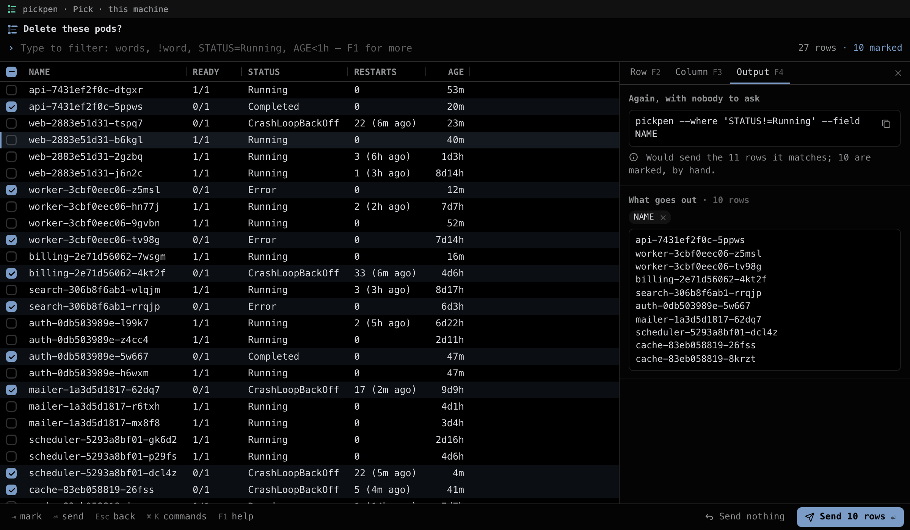
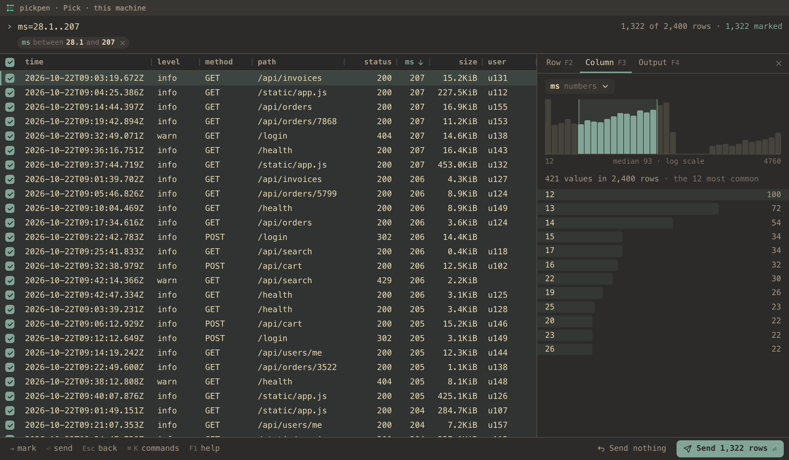
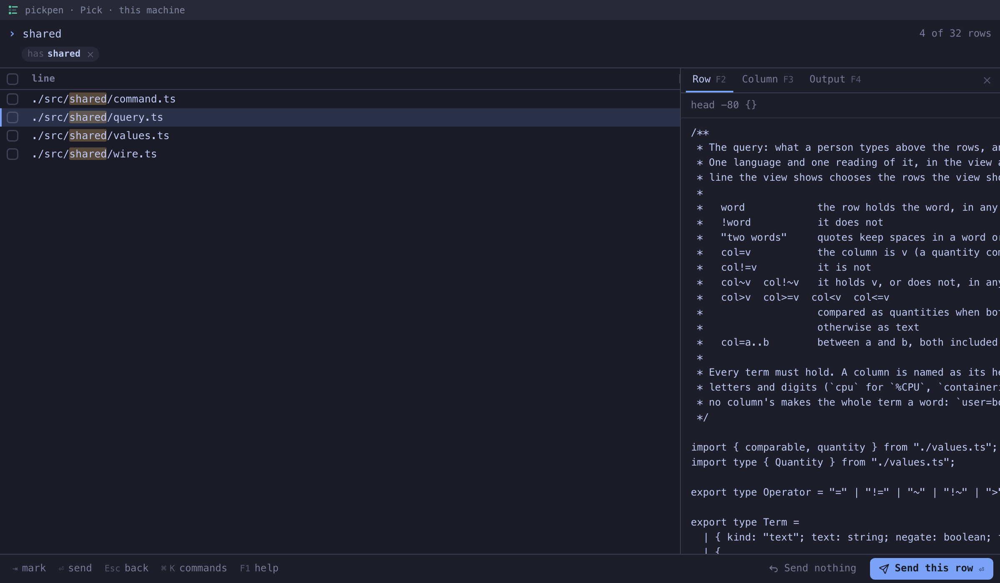
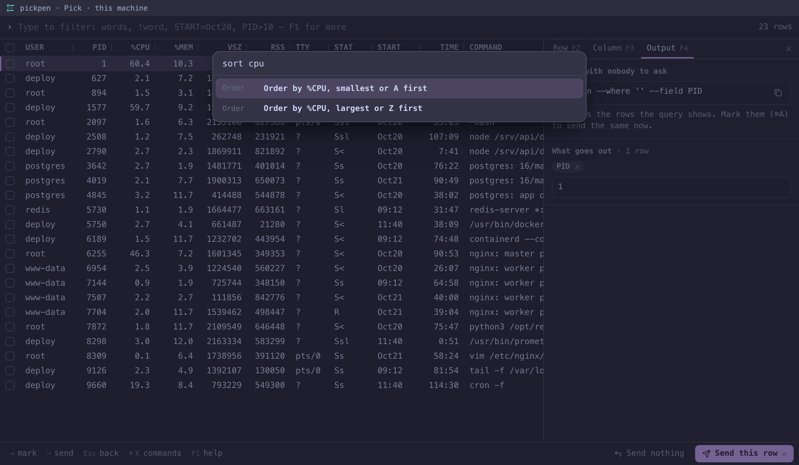
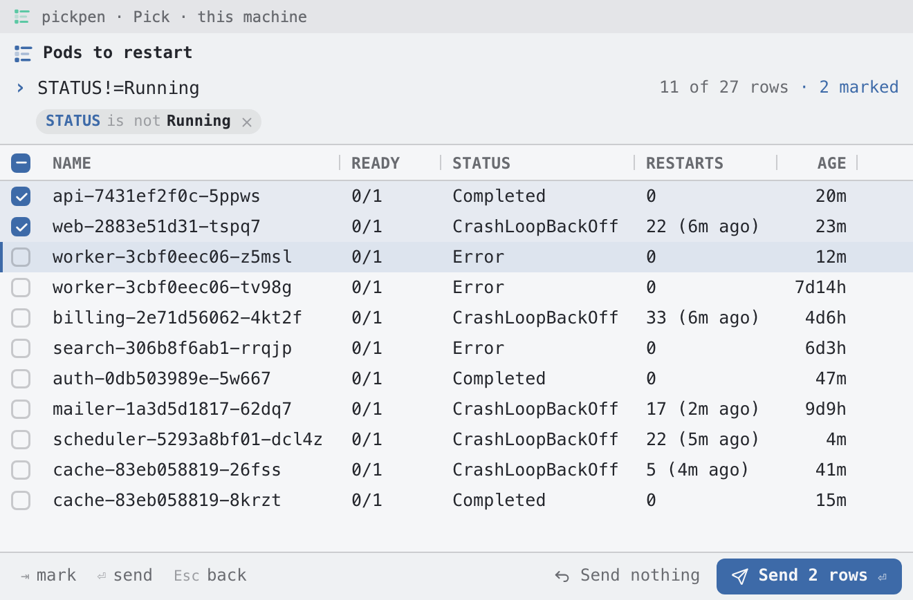

# pickpen

Choose rows in the middle of a pipeline, in a real interface in the terminal pane: the rows
come in on stdin, you filter, sort and mark them with the keyboard or the mouse, and the rows
you chose go out on stdout, to whatever comes next. In the colours and font of your terminal,
on your machine or on a server over plain `ssh`.

```sh
kubectl get pods | pickpen --where 'STATUS!=Running' --confirm --field NAME | xargs kubectl delete pod
```



pickpen is a [pencere](https://github.com/bateri/pencere) program. In a terminal that hosts
pencere views ([bateri](https://github.com/bateri/bateri)) the pane becomes the interface for as
long as you choose, the way `vim` takes the screen and gives it back. The pipeline's data never
touches the terminal: pickpen talks to the terminal on the terminal itself, and keeps stdin and
stdout for the rows.

## What it does

**It reads what commands print.** Lines, CSV and TSV, JSON lines, a JSON document (an array, or
the one array of objects an answer holds, as `kubectl get -o json` and most APIs give), and the
tables commands line up with spaces — `ps aux`, `docker ps`, `kubectl get`, `df -h` — cut into
their columns as they line them up, `Up 2 hours` and `/usr/bin/foo --bar` staying one cell
each. The shape is read from the first lines; `--input` says it when it would be read wrong.
`--delimiter :` cuts each line into columns `1`, `2`, `3` at a text, the last taking the rest of
the line, so that `grep -n`'s `file:line:text` stays three columns when the text holds a colon;
`--read0` reads rows that end at NUL, as `find -print0` writes them. Rows show as they arrive, so
`tail -f app.log | pickpen` works.

**Typing filters.** What you type always goes to the query, so there is nothing to press before
you search. Words are looked for in every column; a column can be compared by its heading, and
quantities are compared as quantities:

| you type                  | the rows kept                                            |
| ------------------------- | -------------------------------------------------------- |
| `web !canary`             | hold `web`, in any column, in any case, and not `canary` |
| `^web` `.log$` `^web$`    | have a cell that starts with `web`, ends with it, is it  |
| `web \| api`              | hold either: a `\|` alone joins the terms on its sides   |
| `STATUS=Running\|Pending` | whose `STATUS` is one of them (`!=` for none of them)    |
| `NAME~api` `NAME!~api`    | whose `NAME` holds `api`, or does not                    |
| `cpu>50` `size>=1G`       | `%CPU` above 50, a size of a gigabyte or more            |
| `age<2h` `ms=100..400`    | younger than two hours, between 100 and 400 ms           |
| `started>2026-10-01`      | dates and times compare as moments                       |

A column is named as its heading is, or by its letters alone (`cpu` for `%CPU`). Under the query,
each term says how it was read — `STATUS is not Running`, `has web` — and a click takes it out. A
name that is no column's is looked for as a word, and the view says so.

With `--fuzzy`, or ⌘K's _Fuzzy words_, a plain word is its letters in order with anything between
them, as in fzf — `sqr` finds `src/query.rs` — and the rows come best match first, unless they are
ordered by a column. A quoted word, `!word`, `^word` and `word$` stay as they are typed.

**The mouse writes the query too.** Right-click a cell for _only rows where STATUS is
CrashLoopBackOff_; click a value in a column's panel, ⌘-click another to keep either; drag across
the chart of a column's numbers to keep a range. Each of these writes its term into the query,
where you can read it, change it, and take it with you.

**What goes out is shown before it goes.** The output panel has the exact bytes Send will write,
drawn by the program with the same function that writes them. By default a row goes out as it
came in — a line as its line, a table's row without the heading (so `xargs` gets only rows), CSV
after its heading, JSON lines as lines, a JSON document as an array of the elements chosen.
`--field NAME,PID` writes columns tab-separated (`--field 1` is the first word of a line, as in
awk), `--format 'kill {PID}'` fills a template, `--output json` converts, and `--print0` ends
each row with NUL rather than a line end, for `xargs -0`. Right-click a heading to send only that
column.

**And how to do it again, with nobody to ask.** The same panel shows the command line that
chooses the same rows in a script or in cron — the query as `--where`, the order as `--sort`, the
columns as `--field` — and says whether it does: it does when the rows marked are exactly the
rows the query matches. Rows marked one by one have no query that names them, and the panel says
that too.

**A rule marks, a person confirms.** With `--where` alone nobody is asked: the rows the query
matches go out, as grep would, one by one as they come. Add `--confirm` and the view opens with
those rows marked; you look, unmark what should stay, and send. Without a terminal that shows
views, anything that needs a person ends with status 2 and sends nothing: pickpen never confirms
for you.

**A preview of the row the cursor is on.** `--preview 'git show --color {1}'` runs on the machine
pickpen runs on, with `{}`, `{COLUMN}` and `{2}` quoted for the shell — `{q}` is the query, and
`{+}`, `{+COLUMN}` each marked row (or the cursor's) — in a session of its own with no terminal and
no stdin, and shows what it prints, colours and all.

**One more key that sends, and says so.** `--expect ctrl-o,f5` makes those keys send as Enter does,
and the first line written is the key that sent (empty for Enter, and for `--where`), so that a
script can open what was chosen one way or another:

```sh
out=$(git ls-files | pickpen --fuzzy --expect ctrl-o) || exit
key=$(printf '%s\n' "$out" | head -1); file=$(printf '%s\n' "$out" | sed 1d)
if [ "$key" = ctrl-o ]; then open "$file"; else vim "$file"; fi
```

|                                                                     |                                                         |
| ------------------------------------------------------------------- | ------------------------------------------------------- |
|  |               |
|                                     |  |

## The keyboard, and the mouse

Typing always goes to the query; the commands are on keys that do not type. Everything the keys
do the mouse does too, the bottom line has the keys that matter most (each one a button), and
`F1` lists them all.

|                      |                                                                                                      |
| -------------------- | ---------------------------------------------------------------------------------------------------- |
| `↑` `↓` / `⌃P` `⌃N`  | move; `PgUp` `PgDn` a page, `⌘↑` `⌘↓` the first and the last row                                     |
| `Tab` `⇧Tab`         | mark the row and go on (space types a space)                                                         |
| `⇧↑` `⇧↓`            | mark a run of rows                                                                                   |
| `⌘A`, `⇧⌘A`          | mark every row shown, unmark every row                                                               |
| `⏎`                  | send: the marked rows, or the row under the cursor                                                   |
| `Esc`                | back: close what is open, then clear the query, then send nothing (asked twice when rows are marked) |
| `⌃1`–`⌃9`, `⌃0`      | order by that column (again for the other way), the input's order                                    |
| `⌘K`                 | every command, a column's own among them                                                             |
| `⌘I`, `F2` `F3` `F4` | the side panel: the row, a column, what goes out                                                     |
| `⌘C`                 | copy the row                                                                                         |
| `⌃C`                 | quit, sending nothing                                                                                |

The box in front of a row marks it, and a drag down the boxes marks every row it passes;
⌘-click marks one row and ⇧-click a run; a double-click sends the row when nothing is marked
(never with `--confirm`); a click on a heading orders by it, and its edge resizes it. No click
takes the keyboard from the query.

The keys a terminal keeps for itself never reach a view — in bateri `⌘P`, `⌘W`, `⌘O`, `⌘T`,
`⌘N`, `⌘D` and `⌘1`–`⌘9` — and no command is on `⌥` and a letter, which is how a Mac types
`@`, `#`, `[` or `{` on many layouts. On Linux and Windows, `⌘` is `Ctrl`.

## Run it

pickpen is one file, with nothing to install beside it, for macOS on Apple silicon and Linux on
arm64 and x86_64:

```sh
curl -fsSL https://raw.githubusercontent.com/bateri/pickpen/main/install.sh | sh
```

The installer takes the newest release (or `PICKPEN_VERSION=0.1.0`), checks it against the
release's `SHA256SUMS`, and puts it in `~/.local/bin` (`PICKPEN_INSTALL=<dir>` puts it elsewhere).
A file a browser downloads is quarantined by macOS; one curl downloads is not.

To choose in a view you need a terminal that hosts pencere views. bateri is the first, and no
release of it has them yet: until one does, build bateri from its `main` branch. `--where`
without `--confirm` needs no terminal at all.

```sh
ps aux | pickpen --field PID | xargs kill
git log --oneline | pickpen --preview 'git show --color {1}' --field 1 | xargs git cherry-pick
pickpen --where 'level=error' --output json < app.jsonl > errors.json
```

| status | means                                                                    |
| ------ | ------------------------------------------------------------------------ |
| 0      | rows went out                                                            |
| 1      | none did: nothing was chosen, Send nothing, or `--where` matched nothing |
| 2      | a person was needed and there was no terminal that shows pencere views   |
| 64, 65 | the command line was wrong; the input could not be read as its shape     |
| 66     | the file named could not be read                                         |
| 130    | ⌃C                                                                       |

**Nothing chosen, nothing sent.** Every command of a pipeline starts at once, and the one after
pickpen sees its input end whether rows came or not: `xargs -r` runs nothing on no input, but
`mail` sends an empty mail. A step that must not run without a choice waits for it:

```sh
pods=$(kubectl get pods | pickpen --confirm --where 'STATUS!=Running' --field NAME) \
  && printf '%s\n' "$pods" | xargs kubectl delete pod
```

**Over ssh.** Install it on the server and run it there, in a pane of a terminal that hosts
pencere: nothing listens on a port, the interface travels in the terminal's own stream, and it
runs on your machine in a sandbox that reaches nothing but its program. The rows stay on the
server: the view asks for the ones in sight, a window at a time, and the program filters, sorts
and marks them where they are, so a million rows are as quick to scroll as a hundred.

pickpen is never an MCP server on stdio: its stdin and stdout are the pipeline's, and it does not
guess whether it is in one (pencere §13).

## How it works

- `src/program/input.rs` reads the input as it comes, telling its shape from the first lines, and
  keeps each record's own text, which is what goes out when the output has the input's shape.
- `src/program/query.rs` is the query, and the order. The program holds the rows and runs it for
  the view and for `--where` alike, so the command line the view shows chooses what the view
  showed. A test runs `--where` and a view sending the rows the query matches, in a pane, and
  compares the bytes.
- `src/program/output.rs` writes what goes out; the view's picture of it is drawn by the same
  function.
- `src/program/served.rs` and `picker.rs` are what the view asks of the program: the rows in sight,
  the query, the order and the marks, a column's counts and chart, what goes out. `main.rs` is the
  one place that knows about the terminal: the `pencere` crate opens the view on the terminal
  itself (the controlling terminal) while stdin and stdout carry the rows.
- `src/view` is the interface: a page of pencere's kit, in Lua, that the terminal draws in its own
  font and theme, with [Lucide](https://lucide.dev) icons (`src/assets/icons`). It draws only the
  rows in sight.

## Work on it

```sh
git clone https://github.com/bateri/pickpen && cd pickpen
pencere dev         # the program in this pane, shown again as src/view/ changes
make check          # formatting and clippy, the build, the program's tests, the built program
                    # with nobody to ask and in a pane under pencere-fake-host, the installer
```

`make check` needs Rust 1.88 or later, StyLua (`cargo install stylua --locked --features luau`),
Node 22 for the tests of the built program, and a pencere checkout beside this one with its
stand-in terminal built (`cargo build -p pencere-fake-host`). `make demo` writes the inputs of
`demo/` — made-up pods, processes, an access log, servers and commits — the same every time.

How a version is released is in [RELEASING.md](RELEASING.md), and what each one changed in
[CHANGELOG.md](CHANGELOG.md).

## License

pickpen is free software: you can redistribute it and/or modify it under the terms of the
[GNU General Public License](LICENSE) as published by the Free Software Foundation, either
version 3 of the License, or (at your option) any later version. It is distributed in the hope
that it will be useful, but WITHOUT ANY WARRANTY; see the license for details.
